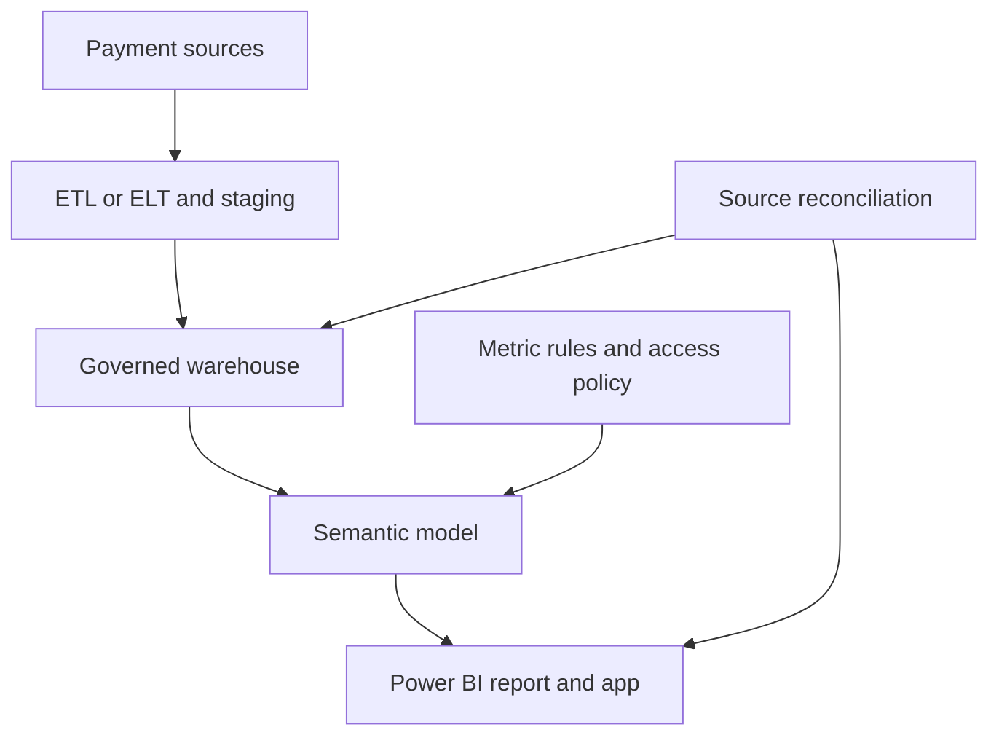

# 💳 PayBridge: payment reliability and settlement visibility

[← Study hub](README.md) · [Measures](practice/measures.dax) · [Practice instructions](practice/README.md)

**One fictional case is used throughout all 97 questions.** PayBridge is a payments provider. Operations needs to investigate failed attempts; Finance needs to reconcile successful payment value and settlement delays. This is an educational design, not a real employer, client engagement or claim of measured production improvement.

## The decision

Identify where payment failures and late settlements require investigation, while preventing retries, mixed date roles and inconsistent denominators from misleading stakeholders.

| Stakeholder | Decision | Evidence needed |
|---|---|---|
| Payments Operations | Which channel/country needs investigation? | Failed attempts, rate, volume and exception records |
| Finance | Which settled payments breached their due date? | Payment ID, due/actual date, settled amount and reconciliation |
| Country manager | How does the assigned region perform? | Accessible regional KPIs with explicit scope |
| Data/platform owner | How should refresh and source access work? | Freshness SLA, workload, connection and ownership |
| Security owner | Who can see which rows? | Entitlements, consumer roles and negative-access tests |

## The reporting route

Power Query may perform part of preparation; a warehouse pipeline may prepare stable transformations upstream. The model holds shared measures and relationships. The report presents those measures for decisions. The local JSON fixture substitutes for governed source views during learning.

**Release route:** Dev → QA/UAT → Prod. Review metric definitions, transformations, model changes, access and regression results before production distribution. Deployment features and licensing depend on the environment; the sequence is the governance practice, not proof that a deployment pipeline has been executed here.

## Grain and schema

| Table | One row represents | Key fields and important attributes |
|---|---|---|
| FactAttempt | One canonical payment attempt | AttemptID; PaymentID; MerchantKey; CountryKey; ChannelKey; AttemptDate; Status; AmountINR; FeeRate |
| FactSettlement | One completed payment settlement in this fixture | SettlementID; PaymentID; MerchantKey; CountryKey; ChannelKey; SuccessfulAttemptDate; DueDate; SettlementDate; AmountINR |
| DimMerchant | One merchant in the current-reference example | MerchantKey; CountryKey (security attribute); Merchant; City; RiskTier |
| DimCountry | One country | CountryKey; Country |
| DimChannel | One channel | ChannelKey; Channel |
| DimDate | One calendar date | Date; Year; MonthNumber; YearMonth; YearMonthSort |
| UserCountryAccess | One user/country entitlement | UPN; CountryKey; disconnected lookup used by the example RLS rule |

All monetary amounts are already in **INR reporting currency**. Real conversion needs an approved rate source, effective date and rounding policy. Business dates in the fixture are already normalised; real timestamp preparation must agree timezone and cutoff.

A PaymentID can have multiple AttemptID values. The fixture has at most one successful attempt per PaymentID. Multiple successful captures, partial settlements, refunds, chargebacks, reversals and pending settlements need additional explicit business rules and grain decisions before adapting this model.

## Base relationships

Create **one-to-many, single-direction** relationships from each dimension to its fact tables:

| One side | Many side | State |
|---|---|---|
| DimMerchant[MerchantKey] | FactAttempt[MerchantKey] | Active |
| DimMerchant[MerchantKey] | FactSettlement[MerchantKey] | Active |
| DimCountry[CountryKey] | FactAttempt[CountryKey] | Active |
| DimCountry[CountryKey] | FactSettlement[CountryKey] | Active |
| DimChannel[ChannelKey] | FactAttempt[ChannelKey] | Active |
| DimChannel[ChannelKey] | FactSettlement[ChannelKey] | Active |
| DimDate[Date] | FactAttempt[AttemptDate] | Active |
| DimDate[Date] | FactSettlement[SettlementDate] | Active |
| DimDate[Date] | FactSettlement[DueDate] | Inactive; activated only in the named due-date measure |

**Do not join the two fact tables directly by PaymentID in the base model.** Shared dimensions filter each fact independently. Keep UserCountryAccess disconnected for the documented DimCountry role expression. Use DimCountry for country slicers; the merchant dimension has City and a CountryKey security attribute, but no duplicate country-name slicer. Do not add a second active country-to-merchant relationship to this base design.

Mark DimDate as the date table for the classic examples and sort YearMonth by YearMonthSort. A selected date filters attempts by AttemptDate and settlements by actual SettlementDate; explain that distinction. The inactive DueDate path is used only by the due-date measure.

## Security-rule scope

Use the DimCountry entitlement rule from question 041. Also protect DimMerchant with the same entitlement test using DimMerchant[CountryKey], so unauthorised merchant/city attributes are not exposed independently of fact measures. Apply `UserCountryAccess[UPN] = USERPRINCIPALNAME()` as a separate rule on UserCountryAccess itself. Hiding an entitlement table is not access protection. Test all three rules in the same assigned consumer role; multiple roles can widen access through union.

## Metric dictionary

| Metric | Definition | Interpretation |
|---|---|---|
| Attempt Count | Rows in FactAttempt under current scope | Retries are attempts and remain included |
| Successful Attempts | Attempt rows with Status = Succeeded | Not all attempts for a payment that eventually succeeded |
| Failed Attempts | Attempt rows with Status = Failed | Not distinct customers or distinct logical payments |
| Success Rate | Successful Attempts ÷ Attempt Count | Attempt-based; blank with no denominator |
| Failure Rate | Failed Attempts ÷ Attempt Count | Only complementary to success rate when statuses are exhaustive as in the fixture |
| Logical Payment Success Rate | Distinct successful PaymentID ÷ distinct eligible PaymentID | Different denominator; separate metric, not a replacement without approval |
| Successful Amount INR | Sum AmountINR for successful attempts | Failed retry values are not added |
| Fee Revenue INR | Sum successful AmountINR × FeeRate | Teaching policy; production fee and rounding rules need approval |
| Settled Amount INR | Sum AmountINR in completed FactSettlement rows | Scoped by actual settlement date in the base model |
| Late Settlements | Completed rows with SettlementDate > DueDate | Equal date is on time; not a measure of pending overdue payments |
| Late Settlement Rate | Late Settlements ÷ completed settlement count | Does not include unsettled obligations |
| Mean Settlement Days | Mean calendar-day difference from successful attempt to actual settlement | Calendar days, not business-day SLA |
| Country Share of All | Country successful amount ÷ amount across countries, retaining other intended filters and RLS | Not necessarily share of only visibly selected countries |

If statuses also include Pending or Unknown, success plus failure need not equal 100%. If settlement events are split or repeated, redesign the settlement grain and metric before counting rows.

## Expected fixture results

Use **2026-01-01 through 2026-02-28** inclusive, or the half-open interval ending **2026-03-01**, for this baseline. The fixture also includes two 2025 attempts for prior-year comparisons.

| Check | Expected value |
|---|---:|
| Attempts | 10 |
| Successful / failed attempts | 6 / 4 |
| Attempt success / failure rate | 60% / 40% |
| Distinct logical payments | 8 |
| Logical-payment success rate | 75% |
| Successful amount | INR 4,100 |
| Fee revenue | INR 56 |
| January / February successful amount | INR 3,000 / INR 1,100 |
| Corresponding 2025 successful amount | INR 900 |
| Completed / late settlements | 6 / 3 |
| Late settlement rate | 50% |
| Late-settled amount | INR 2,800 |
| Mean settlement days | 10/6 ≈ 1.667 |

Successful amounts by country are India 1,600; UK 1,500; Singapore 700; US 300. UAE has an attempt but no success, so a raw successful SUM measure can display blank there; a displayed zero requires an explicit presentation policy.

The fictional regional-ops identity has India and Singapore access: **7 attempts**, **4 successful attempts**, **INR 2,300 successful amount** in the baseline. An unmapped identity has no entitlement. Python checks these expectations; actual RLS enforcement still requires Power BI service consumer testing.

## Acceptance criteria to carry into UAT

- Attempt IDs are unique and dimension keys have no unresolved duplicates or orphans.
- Date, country and channel selections agree with independent source counts and amounts.
- Overall rates use overall numerators and denominators, not an unweighted average of subgroup rates.
- Global benchmark cards retain their labelled scope and remain subject to RLS.
- Negative-access tests pass for unmapped and unauthorised identities using consumer permissions.
- Freshness is visible; refresh failure or incomplete upstream loads do not imply a healthy current report.
- Performance and freshness targets are agreed and measured; no actual production SLA is claimed by this fixture.

Advanced questions propose SCD2, bridges, different connectivity and embedded access as extensions to this same business case. Those extensions are not silently implemented in the small base fixture.
