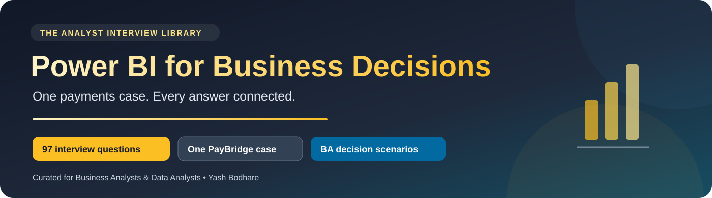

# Power BI for Business Decisions 📊

**Understand the feature. Apply it to one business case. Validate the decision.**

A combined interview and revision library curated by **Yash Bodhare**, with all **97 questions** from the supplied Codebasics question list. Every question has a clear answer and a specific Business Analyst application in the **same fictional PayBridge payments case**.

PayBridge investigates payment failures and settlement delays. The case keeps sources, table grain, relationships, measures and stakeholder decisions consistent across Power Query, modelling, DAX, report design, service deployment and interview scenarios.

> [!TIP]
> Read the shared case first. Attempt each question before expanding its answer, then practise explaining the situation, your approach, validation and decision aloud.

## 🧭 One combined pack

| Resource | What you get |
|---|---|
| [💳 Shared PayBridge case](CASE_STUDY.md) | Problem, stakeholders, pipeline, schema, relationships and metric definitions |
| [🟨 Cheat sheet](CHEAT_SHEET.md) | Power Query, modelling, DAX, visuals, service and validation reminders |
| [🟡 Power Query · 001–011](chapters/01-power-query.md) | Preparation, folding, M, joins, parameters and data quality |
| [🟠 Data modelling · 012–023](chapters/02-data-modelling.md) | Grain, dimensions, relationships, columns, measures and scale |
| [🟣 Report design · 024–036](chapters/03-report-design.md) | Filters, interactions, bookmarks, visuals and user choices |
| [🔵 Service and connectivity · 037–050](chapters/04-service-and-connectivity.md) | Licensing, access, refresh, gateways, Fabric and storage choices |
| [🟢 DAX · 051–076](chapters/05-dax.md) | Context, calculations, virtual tables, percentages and time intelligence |
| [🔴 Scenarios and stakeholders · 077–097](chapters/06-scenarios-and-stakeholders.md) | Every supplied scenario question, including requirement changes |
| [🧪 Fixture and practice](practice/README.md) | Fictional JSON data, reference checks, model setup and a Desktop/UAT checklist |
| [🛡️ Technical review notes](EDITORIAL_NOTES.md) | Corrections, current terminology, official references and check limits |
| [📚 Coverage and credit](SOURCES.md) | Source section/page mapping for all 97 entries |
| [🚀 GitHub setup](SETUP.md) | Upload the complete folder and link it from your portfolio |

## 🧑‍💼 How each answer works

1. **Clear answer:** explain the function or feature in straightforward terms.
2. **Applied example:** DAX or M where a short example helps; 45 question entries include one.
3. **PayBridge situation:** a concrete need in the same payments case.
4. **BA approach:** the requirement, analysis or implementation collaboration.
5. **Validation:** the records, boundaries, filters or access to check.
6. **Decision:** explain what the team can do with reliable evidence.

> “At fictional PayBridge, I would **[approach]** to address **[need]**. I would verify **[business rule and edge cases]** before using the result to support **[decision]**.”

Hypothetical scenarios are practice material. They do not claim real employment, licences, production implementation or measured improvements. For experience questions, use your actual project evidence.

## 🎯 The distinction that matters

In the learning fixture, January–February 2026 contains **10 attempts but 8 logical payments**. There are **6 successful attempts**: the attempt success rate is **60%**, while the logical-payment success rate is **75%**. Those are different metrics, not contradictory results. Every answer follows the shared metric dictionary rather than switching denominators silently.

The report path is source → ETL/ELT and staging → warehouse → semantic model → Power BI report/app. Changes follow Dev → QA/UAT → Prod with checks for metrics, access, freshness and performance.

## ✅ What has been validated

All 97 entries have a PayBridge scenario, approach, validation and decision. Eight independent Python checks passed against the fictional dataset, including grain, rates, amounts, date grouping, settlements and entitlement expectations. Internal links and Markdown structure were checked.

**DAX and M were reviewed, not executed in a Power BI engine here.** The [practice checklist](practice/README.md) explains how to complete Desktop and service checks. No PBIX, live dashboard or production deployment is claimed by this pack.

The supplied question list is dated July 2023. Answers use current terminology and point to official documentation for version-sensitive service, licensing and DAX behaviour.

## 🎨 Visual design

The charcoal, amber and blue banner distinguishes this pack from SQL and Python. GitHub controls body fonts and most text colouring; the banner, badges, icons, tables, callouts and expandable answers provide the supported styling.

Source question checklist credit: **Codebasics**. Added answers and PayBridge applications are curated study material; no affiliation or endorsement is implied.
